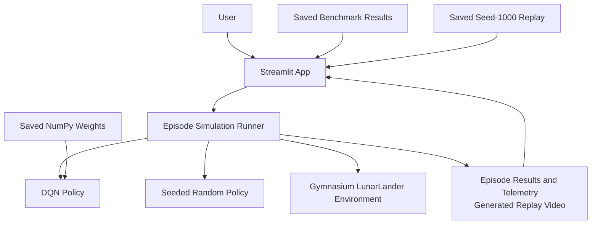

# Lunar Lander Agent Explorer

I built this Streamlit app to inspect a saved Lunar Lander DQN one episode at a time and compare its behavior with a random policy. A training score alone does not show what the agent does in individual episodes, so the app pairs replay and telemetry with a separate seeded evaluation.

The original DQN was trained for DeepLearning.AI coursework. I kept that checkpoint and added NumPy inference, the Gymnasium evaluation pipeline, the Streamlit explorer, and Docker packaging (with AI assistance). The app does not train or modify the model.

## Features

- **Episode replay:** Start with a saved illustrative DQN replay or generate a new episode using DQN or uniform-random actions.
- **Episode controls:** Choose a policy and integer seed from 0 to 1,000,000. Episodes end on simulator termination/truncation or at 1,000 steps.
- **Telemetry:** View reward, simulator outcome, step count, action counts, cumulative reward over time, and per-step observations/actions. Download a new episode's trace as CSV.
- **Benchmark:** Compare the saved paired 50-seed DQN/random results, summary statistics, rewards by seed, a selected seed, and the raw CSV.
- **Methodology:** Read about the model, evaluation setup, Gym version distinction, and limitations.

## Application screenshots

**No genuine screenshots are in the repository yet.** Add reviewed browser captures of the Episode replay, Benchmark, and Methodology tabs here when available. No placeholder images are used.

## Architecture



At app startup, `load_benchmark()` checks the saved rows and seed list and verifies that the NumPy weights have the hash recorded in the evaluation summary. A newly generated episode is kept in the Streamlit session; it does not overwrite the saved benchmark.

## How it works

The inference policy loads three weight/bias pairs from `models/dqn_weights.npz`. For each observation, it applies two 64-unit ReLU layers and a four-value linear output layer, then selects the action with the largest Q-value (`argmax`). The network is 8 → 64 → 64 → 4. The app uses NumPy weights at runtime; TensorFlow is only needed for the separate checkpoint-verification step.

Gymnasium supplies an eight-value observation: normalized horizontal and vertical position, horizontal and vertical velocity, lander angle, angular velocity, and two leg-contact flags. The discrete actions are coast, left engine, main engine, and right engine. The app sums the environment's per-step rewards into an episode score. Those rewards reflect environment state/progress, engine use, and terminal conditions. A high cumulative reward alone does not establish a safe landing.

`run_episode()` resets `LunarLander-v3` with the selected seed. The DQN chooses actions from observations; the random policy uses a seeded NumPy generator. When telemetry is requested, the runner records each step's reward, cumulative reward, action, position, and angle. It also counts actions and derives an outcome from simulator state, such as crash, out of bounds, landed/at rest, or time limit.

For a new replay, the runner requests RGB frames and writes a temporary MP4, sampling every other step and including the final frame. It returns the video bytes, summary, and trace to Streamlit. Before a new run, the app shows the saved DQN seed-1000 replay. That file is one illustrative episode from the prior evaluation environment, not a video summary of the benchmark.

## Evaluation and results

The saved evaluation ran the fixed DQN and uniform-random baseline on the same **50 seeds (1000–1049)** in Gymnasium `LunarLander-v3`. Each episode used a fresh environment, default gravity, no wind, and a 1,000-step cap. The figures below come from `results/summary.json`; the raw 100 episode rows are in `results/episodes.csv`.

| Policy | Episodes | Mean reward | Sample SD | Reward ≥ 200 |
| --- | ---: | ---: | ---: | ---: |
| Saved DQN | 50 | 215.36 | 65.99 | 36 / 50 |
| Uniform random | 50 | -213.18 | 102.15 | 0 / 50 |

The DQN-minus-random mean reward difference is **428.54** in this sample. Reward ≥ 200 is a score threshold, not a landing-success rate; the app reports simulator outcomes separately.

The historical course result is separate: a rolling mean of **200.05 over the final 100 training episodes at episode 455** in **OpenAI Gym `LunarLander-v2`**. The table above is a later evaluation of the saved checkpoint in **Gymnasium `LunarLander-v3`**. They are different environments and measurement contexts, not a single experiment.

The saved MP4 is a single DQN run for seed 1000. It is separate from the 50-seed summary and is not the average episode.

## Tech stack

- Python 3.12
- Streamlit 1.50 and pandas for the UI, tables, and charts
- Gymnasium 1.2.2 with Box2D (`box2d-py` 2.3.5)
- NumPy 2.2.6 for policy inference and random actions
- ImageIO 2.37 and imageio-ffmpeg 0.6.0 for MP4 output
- TensorFlow 2.20 and h5py 3.14 for development-only model verification
- Docker for packaging; the image was built and tested locally. Render is the planned host; no Render deployment is verified.

Runtime pins are in `requirements.txt`; verification dependencies are in `requirements-dev.txt`.

## Project structure

| Path | Purpose |
| --- | --- |
| `app.py` | Streamlit interface, controls, charts, and downloads. |
| `lander/policy.py` | NumPy implementation of the saved DQN inference path. |
| `lander/simulation.py` | Seeded episodes, telemetry, simulator outcome, and optional rendering. |
| `lander/benchmark.py` | Loads and validates saved benchmark data and the model hash. |
| `models/dqn_weights.npz` | Dense-layer weights used by the app; `model_info.json` records provenance. |
| `results/` | Saved v3 episode rows, evaluation summary, and verification smoke results. |
| `assets/evaluation_seed_1000.mp4` | Illustrative replay shown before a new run. |
| `scripts/`, `tests/` | Model export/verification, benchmark runner, and saved-result integrity test. |
| `requirements*.txt`, `Dockerfile` | Dependency pins and container build/start configuration. |

## Run locally

Use Python 3.12. On macOS, Box2D's native dependency may require the Xcode command-line tools. These commands create a project-local virtual environment and install the pinned app dependencies:

```sh
python3.12 -m venv .venv
source .venv/bin/activate
python -m pip install setuptools wheel swig
python -m pip install --no-build-isolation -r requirements.txt
python -m unittest discover -s tests
streamlit run app.py
```

Open the local URL printed by Streamlit. The app reads the recorded benchmark; it does not retrain the agent or run the full evaluation.

To compare the saved NumPy policy with the original H5 model, install the development requirements and run the verifier:

```sh
python -m pip install --no-build-isolation -r requirements-dev.txt
python scripts/verify_model.py
```

The verifier writes `results/smoke_check.json`. `scripts/evaluate.py` writes new benchmark files, so run it only when you intend to replace the saved evaluation.

## Run with Docker

These are the commands used for the local container check on an Apple-silicon Mac. The `linux/amd64` target matches the tested hosting image platform and builds under emulation on this Mac.

```sh
docker build --platform linux/amd64 -t lunar-lander-explorer:local .
docker run --rm --detach --name lunar-lander-smoke \
  -p 127.0.0.1:8080:8080 -e PORT=8080 lunar-lander-explorer:local
curl --fail --silent --show-error --max-time 10 \
  http://127.0.0.1:8080/_stcore/health
curl --silent --show-error --output /dev/null \
  --write-out 'root_http=%{http_code}\n' --max-time 10 http://127.0.0.1:8080
```

The host port is bound to `127.0.0.1` and forwarded to port 8080 in the container. The Dockerfile binds Streamlit to `0.0.0.0` and uses the `PORT` variable (8080 by default). In the completed test, the health endpoint returned `ok` and the root returned HTTP 200. The local image was 1,425,377,073 bytes (about 1.43 GB). After checking the service, stop it with `docker stop lunar-lander-smoke`; `--rm` removes the stopped smoke-test container while the image remains locally.

## Deploy on Render

The app has **not** been deployed to Render. After reviewing and pushing the intended files to GitHub:

1. In the Render Dashboard, choose **New → Web Service**, connect GitHub, and select this repository and branch.
2. Set the service runtime to **Docker** and use the repository-root `Dockerfile`.
3. Choose a region and compute plan. Keep the Dockerfile's start command unless there is a specific reason to override it.
4. In service settings, set the HTTP health-check path to `/_stcore/health`.
5. After deployment succeeds, visit the service URL. Verify health, the benchmark, the saved replay, and a newly generated episode before describing the app as deployed.

The Dockerfile listens on `0.0.0.0` and follows Render's `PORT` (default `10000`). The health endpoint passed locally; its hosted behavior still needs verification. See Render's [Docker deployment guide](https://render.com/docs/docker), [web service setup and port binding](https://render.com/docs/web-services), and [health checks](https://render.com/docs/health-checks).

Render Free web services currently provide 0.1 CPU and 512 MB RAM, spin down after 15 minutes without inbound traffic, and may take about a minute to start again. The app's memory use on this plan has not been measured; verify startup and an episode run, and use a larger plan if it exceeds available memory. Free services have ephemeral filesystems, so local changes disappear on restart or redeploy. This app's model, benchmark, and replay are packaged in the image. Render currently includes 750 free instance-hours per workspace each month, plus bounded bandwidth and build-pipeline usage; check account usage and billing settings because overages can suspend service/builds or incur charges depending on account setup. Render describes Free instances as suitable for hobby projects and previews, not production. See [Free plan limitations](https://render.com/docs/free) and [compute plans](https://render.com/docs/compute-plans).

## Testing and verification

These checks have passed:

- `python scripts/verify_model.py` in the project environment: TensorFlow and NumPy predictions were within `rtol=atol=1e-4`, with 100% action agreement. The seeded episode repeated consistently on the Mac.
- `python -m unittest discover -s tests`: the saved benchmark summary matched the raw rows (1 test passed). This checks the saved data; it does not rerun the benchmark.
- Streamlit `AppTest`: startup, DQN and random episode runs, changed/repeated seeds, telemetry/action totals, and MP4 decoding passed without app exceptions.
- Local Docker test: the `linux/amd64` image built; health returned `ok`, root returned HTTP 200, and an in-container smoke check loaded the model, benchmark data, replay, and a seeded episode.

Streamlit `AppTest` checks app execution and callbacks, not screenshot-level visual layout. No Render deployment has been tested, so local Docker success does not prove Render memory fit or hosted behavior.

## Limitations and future work

- The saved DQN was trained in Gym v2 and evaluated in Gymnasium v3. This is a transfer evaluation, not a reproduction of training. Fifty fixed seeds do not establish performance on new conditions.
- Reward is a cumulative score; reward ≥ 200 is not proof of a successful landing. Use the simulator outcome for that episode's termination context.
- Measure memory during a Render Free episode before relying on the 512 MB plan. The local image is about 1.43 GB; a multi-stage build may reduce build-tool weight, but any size or memory optimization must retain Box2D's runtime libraries and pass the existing container smoke checks.
- Capture genuine screenshots and complete a browser review. Then deploy to Render and verify the hosted episode flow.
- Extend evaluation with additional seeds and varied conditions, keeping new measurements reproducible and separate from the existing data.
- An optional natural-language explanation could summarize recorded episode actions, rewards, and outcome. It is not implemented; any future LLM feature should be clearly distinguished from deterministic telemetry and remain optional.
